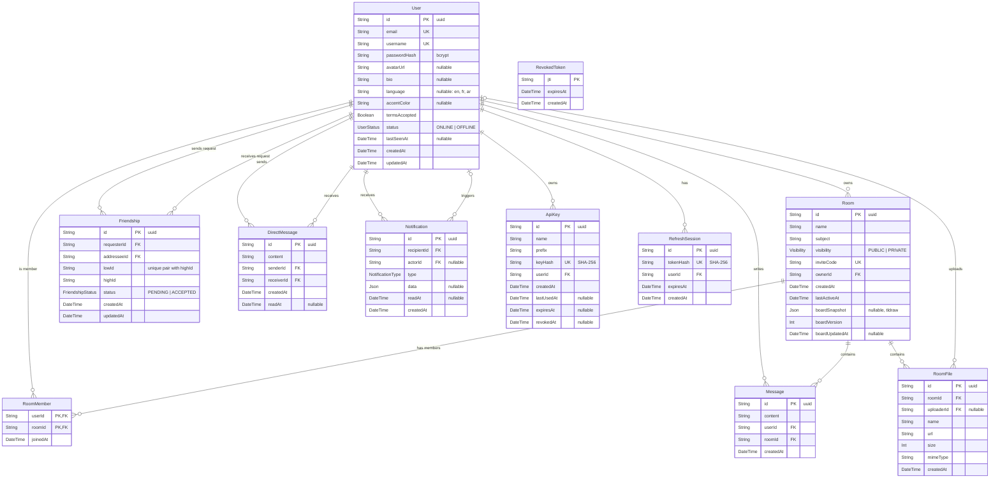

*This project has been created as part of the 42 curriculum by aberkass,iel-fouh [add your login here] *

# Shared Room
## Description
## Instructions
## Team Information

| Login | Role(s) | Responsibilities |
|---|---|---|
| aberkass | Product Owner, Backend Developer | Created and prioritized the product backlog. Built the backend for authentication, users, friendships and real-time presence. |
| iel-fouh | Project Manager, Backend Developer | Organized the team meetings and tracked progress and deadlines. Built the backend for rooms, room chat and notifications. |
## Project Management

- **Organization:** iel-fouh (PM) organized the team meetings and planning sessions. aberkass (PO) kept the product backlog.
- **Task distribution:** the work was split by feature. Each feature was built on its own branch and merged with a pull request that another member reviewed.
- **Tools:** GitHub (repository, branches, pull requests,Issues).
- **Communication:** Discord .
## Technical Stack
## Database Schema

PostgreSQL, managed with Prisma ORM. Source of truth: [backend/prisma/schema.prisma](backend/prisma/schema.prisma).

### Tables

| Table | Purpose |
|---|---|
| `User` | Account, profile, preferences and online status. |
| `Room` | A shared workspace. Holds the whiteboard snapshot. |
| `RoomMember` | Join table: which users are in which rooms (many-to-many). |
| `Message` | A chat message inside a room. |
| `RoomFile` | A file shared in a room. Bytes are on disk; the row keeps the metadata. |
| `Friendship` | A friend request (`PENDING`) or a friendship (`ACCEPTED`). |
| `DirectMessage` | A private message between two friends. |
| `Notification` | An event shown to a user (friend request, new message, file uploaded, ...). |
| `ApiKey` | Key for the public API. Only its hash is stored. |
| `RefreshSession` | A login session. Only the refresh token's hash is stored. |
| `RevokedToken` | Access tokens that were logged out before they expired. |

### Key design choices
- **One friendship per pair:** `lowId` / `highId` hold the two user ids sorted. With `@@unique([lowId, highId])`, A→B and B→A can't both exist.
- **No overwrite on the whiteboard:** `boardVersion` goes up on each save. A save based on an older version is refused.
- **No secrets stored in plain text:** passwords use bcrypt; refresh tokens and API keys use SHA-256.
- **Deleting a user:** their sessions, friendships, DMs and notifications are deleted (`onDelete: Cascade`). Their shared files stay in the room (`uploaderId` becomes `NULL`).

## Features List

| Feature | Who | Description |
|---|---|---|
| Sign up / log in / log out | aberkass | Email and password auth. Passwords are hashed with bcrypt (salted). Login returns a short-lived JWT access token and a refresh token. Logout revokes the access token (its `jti` is saved in a `RevokedToken` table) and deletes the refresh session. |
| User profiles | aberkass | View your own profile and other users' public profiles. Update profile info, change password, delete account, search users. |
| Avatar upload | aberkass | Upload an avatar (JPG, PNG or WebP, max 5 MB) or remove it. Validated on the server (type and size). |
| Friends | aberkass | Send, accept, reject and cancel friend requests. Remove a friend. List friends, sent and received requests (with search and pagination). A notification is created for friend requests. |
| Online status | aberkass | Users see who is online in real time. A user is ONLINE while at least one tab is connected, and OFFLINE 5 seconds after the last tab closes. The status and `lastSeenAt` are saved in the database. |
| Real-time layer (Socket.IO) | aberkass | One WebSocket connection per tab, checked with the JWT at connection time. Each user has a private channel and each room has a room channel. Events (room messages, files, DMs, presence) are sent only after the database write succeeds. Full event list: [backend/docs/websocket.md](backend/docs/websocket.md). |
| Room presence | aberkass | Shows who is inside a room right now. Only room members can join a room channel. "Joined" / "left" events are sent once per user, even with many tabs open. |
| Rooms: create, join and leave | iel-fouh | Create a room with a name, a subject and a visibility (public or private). The creator becomes the owner and the first member, and each room gets an invite code. Join a public room, or a private one with its invite code (also by code alone). Leaving a room passes the ownership to the oldest member if the owner leaves, and the other members are notified. |
| Public room search | iel-fouh | List public rooms with a filter by name and subject, sorting (newest, most active, most members) and pagination with the total count. |
| Shared rooms | iel-fouh | List the rooms that you and a friend both belong to. |
| Room chat and mentions | iel-fouh | Real-time chat inside a room, only for members. History is saved and loaded page by page (cursor pagination). A member can delete their own message, and the room owner can delete any message. Writing `@username` in a message notifies that member: only room members can be mentioned, and a person gets one notification per message. |
| Notifications | iel-fouh | Notification service with a REST API (list with pagination, filter by category, unread count, unread count per room, mark one or all as read, delete). Notifications are sent live over Socket.IO (new, updated, read, deleted). They are created for: friend request sent and accepted, direct message (grouped into one unread notification per sender), room created, member joined or left, new room message, mention... Cancelling a request, removing a friend or deleting a message removes the matching notification. |
## Modules

| Module | Type | Points | Who |
|---|---|---|---|
| Standard user management and authentication | Major | 2 | aberkass |
| Real-time features using WebSockets | Major | 2 | aberkass |
| Allow users to interact with other users (chat, profile, friends) | Major | 2 | aberkass (profile, friends), iel-fouh (chat) |
| A complete notification system for all creation, update, and deletion actions | Minor | 1 | iel-fouh |
| Advanced search functionality with filters, sorting, and pagination | Minor | 1 | iel-fouh |

**Standard user management (Major, 2 pts)**
- Why: Shared Room is a social workspace, so users need profiles, avatars and friends.
- How: NestJS `users` and `friends` modules with Prisma. Profile update (`PATCH /users/me`), avatar upload (`POST /users/me/avatar`), public profile page (`GET /users/:id`), full friend request flow (`/friends/...`). Friends' online status comes from the real-time module.

**Real-time features using WebSockets (Major, 2 pts)**
- Why: whiteboard, chat, files and presence must update for every user at the same time.
- How: a Socket.IO gateway in NestJS. The JWT is checked before a socket is accepted. Users and rooms each get their own channel, so events go only to the people who need them. Disconnects are handled gracefully: a 5-second grace period avoids "offline" flicker when a user refreshes the page, and room "left" events are sent when the last tab closes.

**Allow users to interact (Major, 2 pts)**
- Why: users must find each other and talk inside the app.
- How: aberkass built the profile and friends systems (see above). iel-fouh built the chat.

**Notification system (Minor, 1 pt)**
- Why: users need to know what happens without refreshing the page.
- How: a `NotificationsService` creates a notification for creation, update and deletion events (friend requests, direct messages, room activity, messages, mentions). Each notification is pushed to the user's private Socket.IO channel.  When the related thing is deleted, the notification is deleted too.

**Advanced search (Minor, 1 pt)**
- Why: with many rooms, users need to find the right one quickly.
- How: `GET /rooms/public` accepts `name`, `subject`, `sort` and `page`/`limit`. The filters are case-insensitive, the response includes the total count and the number of pages. 

## Individual Contributions

### aberkass — Product Owner, Backend Developer
- **Project:** wrote the product backlog, created the GitHub repository and the Discord server.
- **Auth:** register, login, refresh, logout, JWT guard on every route, token revocation.
- **Users:** profile, avatar upload, password change, account deletion, user search.
- **Friendships:** friend requests, friends list, notifications for friend events.
- **Real-time:** Socket.IO gateway, presence service, user and room channels, WebSocket docs.

### iel-fouh — Project Manager, Backend Developer
- **Project management:** organized the team meetings and planning.
- **Rooms:** create a room, join, leave, public room list with filters, sorting and pagination, shared rooms with a friend.
- **Room chat:** send and read messages with membership checks, delete by the author or the owner.
- **Mentions:** `@username` detection in messages and a dedicated notification.
- **Notifications:** the notification service, its REST API and live events, categories, unread counts (global and per room), and the cleanup of notifications when requests, friendships or messages are removed.
## Resources
