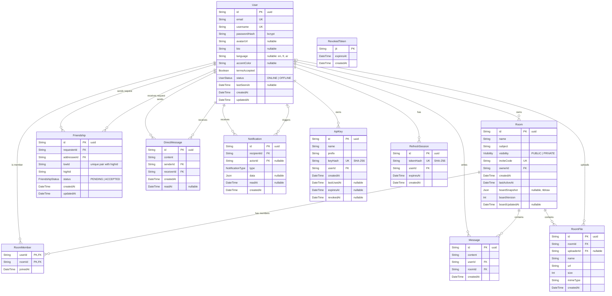

*This project has been created as part of the 42 curriculum by aberkass, iel-fouh and yolaoual.*

# Shared Room
## Description
## Instructions
## Team Information

| Login | Role(s) | Responsibilities |
|---|---|---|
| aberkass | Product Owner, Backend Developer | Created and prioritized the product backlog. Built the backend for authentication, users, friendships and real-time presence. |

## Project Management

- **Organization:** iel-fouh (PM) organized the team meetings and planning sessions. aberkass (PO) kept the product backlog.
- **Task distribution:** the work was split by feature. Each feature was built on its own branch and merged with a pull request that another member reviewed.
- **Tools:** GitHub (repository, branches, pull requests,Issues).
- **Communication:** Discord .
## Technical Stack

### Frontend

| Technology | Use in the project |
|---|---|
| **Next.js 16 (App Router)** | File-based routing, nested layouts, Server Components, server-side rendering of public profiles, metadata generation and optimized production builds. |
| **React 19** | Component-based interface, providers, hooks and interactive client features. |
| **TypeScript** | End-to-end frontend type safety for components, API contracts, query data and application state. |
| **Tailwind CSS 4** | Responsive layouts and utility styling, backed by shared CSS tokens for colors, typography, radii, light/dark themes and accent palettes. |
| **TanStack Query** | Server-state fetching, caching, pagination, mutations, optimistic cache updates, invalidation after real-time events and persisted cache restoration. |
| **Zod** | Runtime validation of structured API responses at the frontend boundary, preventing an invalid backend payload from reaching UI components. |
| **Axios** | Centralized HTTP client with JWT headers, automatic refresh-token retry, normalized API errors, connection monitoring and upload progress. |
| **tldraw and `@tldraw/sync`** | Collaborative whiteboard editor, assets and client connection to the dedicated board synchronization server. |
| **Socket.IO client** | Receives application events for messages, notifications, files and presence, then synchronizes them with the TanStack Query cache. |
| **next-themes** | Persistent light, dark and system theme selection without hydration flicker. |
| **Lucide React** | Consistent accessible icon set across navigation, actions and status displays. |
| **React Select** | Accessible select controls for filters and forms. |
| **ESLint and Prettier** | Static checks and consistent TypeScript, React and Tailwind formatting before integration. |

The frontend also includes a typed in-house internationalization layer. English is the source dictionary, while the French and Arabic dictionaries must satisfy the same TypeScript shape, making missing translations a build error.

### Backend technologies used in yolaoual's features

| Technology | Use in the project |
|---|---|
| **NestJS** | Public REST API modules, guards, DTO validation and Swagger/OpenAPI integration. |
| **Prisma and PostgreSQL** | Database-backed public API operations, API-key records and versioned board snapshots. |
| **`ws` and `@tldraw/sync-core`** | Native WebSocket upgrade handling, authenticated tldraw rooms, ordered changes and board persistence; separate from the Socket.IO gateway. |

## Database Schema

PostgreSQL, managed with Prisma ORM. Source of truth: [backend/prisma/schema.prisma](backend/prisma/schema.prisma).

### Tables

| Table | Purpose |
|---|---|
| `User` | Account, profile, preferences and online status. |
| `Room` | A shared workspace. Holds the whiteboard snapshot. |
| `RoomMember` | Join table: which users are in which rooms (many-to-many). |
| `Message` | A chat message inside a room. |
| `RoomFile` | A file shared in a room. Bytes are on disk; the row keeps the metadata. |
| `Friendship` | A friend request (`PENDING`) or a friendship (`ACCEPTED`). |
| `DirectMessage` | A private message between two friends. |
| `Notification` | An event shown to a user (friend request, new message, file uploaded, ...). |
| `ApiKey` | Key for the public API. Only its hash is stored. |
| `RefreshSession` | A login session. Only the refresh token's hash is stored. |
| `RevokedToken` | Access tokens that were logged out before they expired. |

### Key design choices
- **One friendship per pair:** `lowId` / `highId` hold the two user ids sorted. With `@@unique([lowId, highId])`, A→B and B→A can't both exist.
- **No overwrite on the whiteboard:** `boardVersion` goes up on each save. A save based on an older version is refused.
- **No secrets stored in plain text:** passwords use bcrypt; refresh tokens and API keys use SHA-256.
- **Deleting a user:** their sessions, friendships, DMs and notifications are deleted (`onDelete: Cascade`). Their shared files stay in the room (`uploaderId` becomes `NULL`).

## Features List

| Feature | Who | Description |
|---|---|---|
| Sign up / log in / log out | aberkass | Email and password auth. Passwords are hashed with bcrypt (salted). Login returns a short-lived JWT access token and a refresh token. Logout revokes the access token (its `jti` is saved in a `RevokedToken` table) and deletes the refresh session. |
| User profiles | aberkass | View your own profile and other users' public profiles. Update profile info, change password, delete account, search users. |
| Avatar upload | aberkass | Upload an avatar (JPG, PNG or WebP, max 5 MB) or remove it. Validated on the server (type and size). |
| Friends | aberkass | Send, accept, reject and cancel friend requests. Remove a friend. List friends, sent and received requests (with search and pagination). A notification is created for friend requests. |
| Online status | aberkass | Users see who is online in real time. A user is ONLINE while at least one tab is connected, and OFFLINE 5 seconds after the last tab closes. The status and `lastSeenAt` are saved in the database. |
| Real-time layer (Socket.IO) | aberkass | One WebSocket connection per tab, checked with the JWT at connection time. Each user has a private channel and each room has a room channel. Events (room messages, files, DMs, presence) are sent only after the database write succeeds. Full event list: [backend/docs/websocket.md](backend/docs/websocket.md). |
| Room presence | aberkass | Shows who is inside a room right now. Only room members can join a room channel. "Joined" / "left" events are sent once per user, even with many tabs open. |
| Rooms: create, join and leave | iel-fouh | Create a room with a name, a subject and a visibility (public or private). The creator becomes the owner and the first member, and each room gets an invite code. Join a public room, or a private one with its invite code (also by code alone). Leaving a room passes the ownership to the oldest member if the owner leaves, and the other members are notified. |
| Public room search | iel-fouh | List public rooms with a filter by name and subject, sorting (newest, most active, most members) and pagination with the total count. |
| Shared rooms | iel-fouh | List the rooms that you and a friend both belong to. |
| Room chat and mentions | iel-fouh | Real-time chat inside a room, only for members. History is saved and loaded page by page (cursor pagination). A member can delete their own message, and the room owner can delete any message. Writing `@username` in a message notifies that member: only room members can be mentioned, and a person gets one notification per message. |
| Notifications | iel-fouh | Notification service with a REST API (list with pagination, filter by category, unread count, unread count per room, mark one or all as read, delete). Notifications are sent live over Socket.IO (new, updated, read, deleted). They are created for: friend request sent and accepted, direct message (grouped into one unread notification per sender), room created, member joined or left, new room message, mention... Cancelling a request, removing a friend or deleting a message removes the matching notification. |
| Frontend foundation and design system | yolaoual | Built the responsive application shell, navigation, reusable UI components, loading and error states, typed API layer, themes and shared design tokens. |
| Authentication and account frontend | yolaoual | Built registration, login and logout screens, automatic access-token renewal, session recovery, password changes and confirmed account deletion flows. |
| Rooms frontend | yolaoual | Built room discovery, creation, joining by code, filtering, sorting, pagination, details, membership actions and owner controls. |
| Collaborative board frontend | yolaoual | Integrated tldraw into the room workspace, connected the editor to the dedicated sync endpoint and supported file assets on the board. |
| Room collaboration frontend | yolaoual | Built room chat, participant presence, message deletion, unread indicators and file upload, progress, preview, authenticated download and deletion interfaces. |
| Friends and direct messages frontend | yolaoual | Built people discovery, friend-request management, friend lists, private conversations, read status and message deletion interfaces. |
| Profiles and dashboard frontend | yolaoual | Built profile editing, avatar management, activity statistics, dashboard views and server-rendered public user profiles with dynamic metadata. |
| Notifications and real-time frontend | yolaoual | Built the notification center, unread states, connection feedback and client-side cache synchronization for events received from Socket.IO. |
| Preferences and localization frontend | yolaoual | Built English, French and Arabic translations, seamless LTR/RTL switching, light/dark/system modes and configurable accent colors. |
| Landing and legal frontend | yolaoual | Built the public landing page, localized metadata, Privacy Policy and Terms of Service pages. |
| API-key management frontend | yolaoual | Built the profile interface for creating, displaying once, copying, listing and revoking keys used by external applications. |
| Public API backend | yolaoual | Built the documented external REST API with hashed API-key authentication, per-key rate limiting and five database-backed room endpoints. |
| Board synchronization backend | yolaoual | Built the tldraw synchronization server over native `ws`, with JWT and room-membership checks, ordered updates and persistent versioned snapshots. This is separate from the Socket.IO real-time layer. |
## Modules

| Module | Type | Points | Who |
|---|---|---|---|
| Standard user management and authentication | Major | 2 | aberkass |
| Real-time features using WebSockets | Major | 2 | aberkass |
| Allow users to interact with other users (chat, profile, friends) | Major | 2 | aberkass (profile, friends), iel-fouh (chat) |
| A complete notification system for all creation, update, and deletion actions | Minor | 1 | iel-fouh |
| Advanced search functionality with filters, sorting, and pagination | Minor | 1 | iel-fouh |
| Public API | Major | 2 | yolaoual |
| Server-side rendering (SSR) | Minor | 1 | yolaoual |
| Custom design system | Minor | 1 | yolaoual |
| File upload and management | Minor | 1 | yolaoual (frontend), backend by a teammate |
| Multiple languages | Minor | 1 | yolaoual |
| Right-to-left language support | Minor | 1 | yolaoual |

**Standard user management (Major, 2 pts)**
- Why: Shared Room is a social workspace, so users need profiles, avatars and friends.
- How: NestJS `users` and `friends` modules with Prisma. Profile update (`PATCH /users/me`), avatar upload (`POST /users/me/avatar`), public profile page (`GET /users/:id`), full friend request flow (`/friends/...`). Friends' online status comes from the real-time module.

**Real-time features using WebSockets (Major, 2 pts)**
- Why: whiteboard, chat, files and presence must update for every user at the same time.
- How: a Socket.IO gateway in NestJS. The JWT is checked before a socket is accepted. Users and rooms each get their own channel, so events go only to the people who need them. Disconnects are handled gracefully: a 5-second grace period avoids "offline" flicker when a user refreshes the page, and room "left" events are sent when the last tab closes.

**Allow users to interact (Major, 2 pts)**
- Why: users must find each other and talk inside the app.
- How: aberkass built the profile and friends systems (see above). iel-fouh built the chat.

**Notification system (Minor, 1 pt)**
- Why: users need to know what happens without refreshing the page.
- How: a `NotificationsService` creates a notification for creation, update and deletion events (friend requests, direct messages, room activity, messages, mentions). Each notification is pushed to the user's private Socket.IO channel.  When the related thing is deleted, the notification is deleted too.

**Advanced search (Minor, 1 pt)**
- Why: with many rooms, users need to find the right one quickly.
- How: `GET /rooms/public` accepts `name`, `subject`, `sort` and `page`/`limit`. The filters are case-insensitive, the response includes the total count and the number of pages. 

**Public API (Major, 2 pts)**
- Why: approved external applications need a secure, documented way to interact with Shared Room data without using a user's password or browser session.
- How: the versioned REST API uses revocable API keys stored as SHA-256 hashes, per-key rate limiting and Swagger/OpenAPI documentation. Its five database-backed room endpoints include two `GET` operations and one each for `POST`, `PUT` and `DELETE`.

**Server-side rendering (SSR) (Minor, 1 pt)**
- Why: a public profile should deliver meaningful content in its initial HTML for faster first rendering, link previews and search-engine indexing.
- How: Next.js renders each public user profile on the server, fetches its public data directly from the backend and generates profile-specific metadata. The hydrated client view keeps navigation and interactive behavior working afterward.

**Custom design system (Minor, 1 pt)**
- Why: shared visual rules and components keep a large interface consistent, accessible and easier to maintain.
- How: CSS design tokens define the color palette, light and dark themes, accent palettes, typography and radii, while Tailwind provides a consistent spacing scale. More than ten reusable React components cover buttons, inputs, fields, modals, dropdowns, tabs, avatars, toasts, pagination, tables, selects and loading states, with Lucide providing a consistent icon set.

**File upload and management (Minor, 1 pt)**
- Why: users need safe profile images and room file sharing with clear feedback throughout the upload lifecycle.
- How: yolaoual built the frontend for avatar and room-file uploads, including type and size validation, drag and drop, image/PDF previews, image preparation, upload progress, authenticated downloads and confirmed deletion. A teammate implemented the backend validation, storage and access controls.

**Multiple languages (Minor, 1 pt)**
- Why: users should be able to use the entire application in their preferred language rather than only translating isolated pages.
- How: the typed i18n system provides complete English, French and Arabic dictionaries, a persistent language switcher and localized interface text, validation messages, errors, notifications and metadata. A missing French or Arabic key fails the TypeScript build.

**Right-to-left language support (Minor, 1 pt)**
- Why: Arabic requires more than translated strings; navigation, alignment and reading direction must follow RTL conventions without damaging mixed-language content.
- How: selecting Arabic switches the document to `dir="rtl"`, mirrors layouts through logical CSS utilities, prioritizes an Arabic font and protects mixed-direction usernames, filenames and codes with directional markup. Switching back to English or French restores the LTR layout.

## Individual Contributions

### aberkass — Product Owner, Backend Developer
- **Project:** wrote the product backlog, created the GitHub repository and the Discord server.
- **Auth:** register, login, refresh, logout, JWT guard on every route, token revocation.
- **Users:** profile, avatar upload, password change, account deletion, user search.
- **Friendships:** friend requests, friends list, notifications for friend events.
- **Real-time:** Socket.IO gateway, presence service, user and room channels, WebSocket docs.

### aben-hzz — Developer (DevOps)
- **Docker:** Compose stack with nginx, frontend, backend and Postgres, plus two one-shot jobs (database migrations, TLS certificate). Multi-stage Dockerfiles running as non-root users. Named volumes for the database and uploads.
- **One-command start:** Makefile (`make`, `up`, `down`, `logs`, `fclean`, `re`…) that refuses to start without a `.env` file.
- **nginx:** single HTTPS entry point (self-signed certificate, TLS 1.2/1.3, HTTP → HTTPS redirect), routing to the frontend and backend, Socket.IO WebSocket proxying, security headers.
- **Healthchecks:** for Postgres, backend, frontend and nginx, so services start only when their dependencies are ready. Private health endpoint for nginx.

### iel-fouh — Project Manager, Backend Developer
- **Project management:** organized the team meetings and planning.
- **Rooms:** create a room, join, leave, public room list with filters, sorting and pagination, shared rooms with a friend.
- **Room chat:** send and read messages with membership checks, delete by the author or the owner.
- **Mentions:** `@username` detection in messages and a dedicated notification.
- **Notifications:** the notification service, its REST API and live events, categories, unread counts (global and per room), and the cleanup of notifications when requests, friendships or messages are removed.

### yolaoual — Yousoufou laouali — Tech Lead, Frontend Developer, Backend Developer
- **Technical leadership:** guided the team’s stack and architecture choices across Next.js, React, TypeScript and Tailwind CSS on the frontend, and NestJS, Prisma and PostgreSQL on the backend.
- **Code quality:** reviewed Pull Requests before integration, checking type safety, consistency with the shared architecture, readability, security-sensitive changes, build and lint results, and potential conflicts or regressions across frontend and backend work.
- **Frontend:** implemented all user-facing features and backend integrations, including authentication, rooms, the collaborative board, room and direct messages, friends, public profiles, file sharing, notifications, profile settings and API-key management.
- **User experience:** built the responsive layouts, reusable UI components, form validation, loading and error states, themes, and English, French and Arabic localization with RTL support.
- **Public API:** implemented the external REST API, secured it with hashed API keys and rate limiting, added Swagger documentation, and built the profile interface used to create and revoke API keys.
- **File management:** implemented the frontend experience for avatar and room-file validation, previews, upload progress, authenticated downloads and deletion; the related backend work was completed by a teammate.
- **Rendering:** implemented server-side rendering and dynamic metadata for public user profiles.
- **Board synchronization:** implemented the tldraw sync server with the native `ws` library, JWT authentication, room-membership authorization, in-memory live rooms and persistent versioned snapshots.
- **Scope clarification:** the board synchronization WebSocket is separate from the Socket.IO gateway; Socket.IO was not part of this contribution.
## Resources
